# 🪖 Smart AI Helmet

An intelligent safety helmet that combines **Artificial Intelligence, IoT and embedded systems** to protect two-wheeler riders and workers in hazardous environments. Unlike a conventional helmet that offers only passive impact protection, the Smart AI Helmet monitors the rider in real time, blocks unsafe riding, and automatically sends an SOS with GPS location after an accident.


<p align="center">
  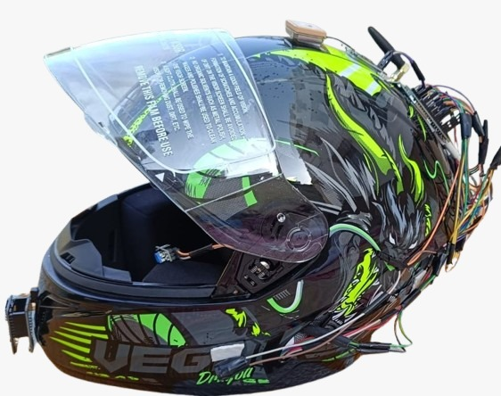
  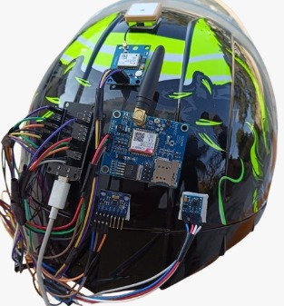
</p>

---

## 📌 Table of Contents

- [Motivation](#-motivation)
- [Features](#-features)
- [System Architecture](#-system-architecture)
- [Hardware Components](#-hardware-components)
- [How It Works](#-how-it-works)
- [Wiring Overview](#-wiring-overview)
- [Software Stack](#-software-stack)
- [Getting Started](#-getting-started)
- [Sample Emergency SMS](#-sample-emergency-sms)
- [Applications](#-applications)
- [Research Gaps Addressed](#-research-gaps-addressed)
- [Future Work](#-future-work)
- [References](#-references)

---

## 🎯 Motivation

Road traffic accidents are a leading cause of death worldwide. The WHO reports roughly **1.35 million** road deaths per year, with motorcyclists accounting for about **28%** of them. The problem is worse in developing countries, where safety infrastructure and helmet adoption are weaker.

This project targets:

- High mortality among two-wheeler riders due to delayed emergency response
- Missing accident detection in remote or sparsely populated areas
- Drunk and drowsy riding
- Lack of real-time monitoring for fleets
- Poor integration between safety gear and emergency services

---

## ✨ Features

| Feature | Description |
|---|---|
| 🍺 **Alcohol detection** | MQ-3 sensor checks the rider's breath; ignition is disabled via relay if the threshold is exceeded |
| 🪖 **Helmet-worn detection** | IR sensor verifies the helmet is worn; the engine will not start otherwise |
| 💥 **Accident detection** | Impact/tilt threshold logic with a verification delay to reduce false triggers |
| 📍 **GPS tracking** | NEO-6M provides latitude, longitude and timestamp |
| 📲 **Emergency SOS** | SIM800L sends an SMS with a Google Maps link and rider details to predefined contacts |
| 📷 **Vision module** | ESP32-CAM for image capture and optional AI-based drowsiness detection |
| 🔔 **Alerts** | Piezo buzzer for alcohol, helmet-not-worn and accident confirmation |
| ☁️ **Cloud dashboard** | Live status on a Blynk dashboard (eyes, strap, alcohol level, status, location) |
| 🗣️ **Voice assistant** | Hands-free interaction using speech recognition and an LLM-based assistant |

---

## 🏗️ System Architecture

The system is organised into four layers.

1. **Hardware Layer**: sensors, camera, GPS, GSM, power.
2. **Processing Layer**: ESP32 for real-time sensor handling and control. A Raspberry Pi can optionally handle heavier AI tasks such as image analysis and translation.
3. **Communication Layer**: MQTT, HTTP/HTTPS, Bluetooth LE, and GSM for emergency SMS.
4. **Application Layer**: Blynk mobile app and dashboard.

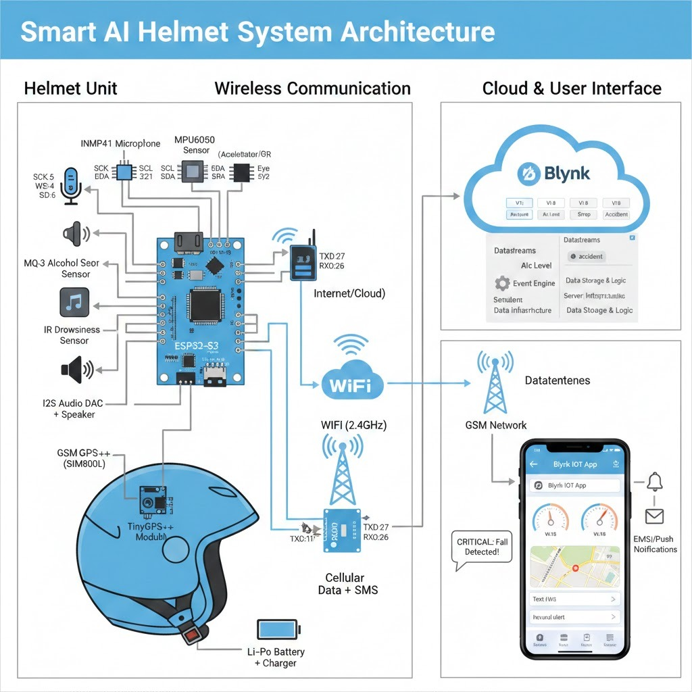
*Fig. 1: System architecture (helmet unit, wireless communication, cloud and user interface).*

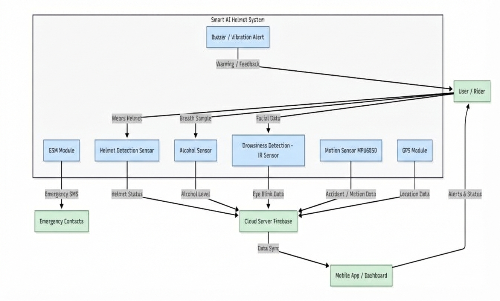
*Fig. 2: Block diagram showing how each sensor feeds the cloud, the dashboard and the emergency contacts.*

### AI & Vision Processing

- **Drowsiness detection**: OpenCV with a CNN or Haar Cascade classifiers to detect closed eyes, yawning or head drooping.
- **Fall detection**: threshold analysis on accelerometer and gyroscope data to detect sudden acceleration or impact.
- **Language translation**: speech-to-text and text-to-speech via cloud AI services (e.g., Google Translate API) or TensorFlow Lite speech models.

---

## 🔧 Hardware Components

| Component | Purpose |
|---|---|
| ESP32 Development Board | Main controller: sensor acquisition, decision logic, GPS/GSM communication, relay and buzzer control |
| ESP32-CAM (OV2640, 2MP) | Image capture, vision monitoring, visual evidence in emergencies |
| MPU6050 (gyroscope + accelerometer) | Orientation and motion for accident detection |
| MQ-3 alcohol sensor | Breath alcohol detection |
| IR sensor module | Helmet-worn / helmet-integrity detection |
| NEO-6M GPS module | Real-time location tracking |
| SIM800L GSM module | Emergency SMS and calls without Wi-Fi |
| 5V relay module | Ignition cut-off |
| Piezo buzzer | Audible warnings |
| 3.7V Li-ion battery (18650) | Power source |
| TP4056 module | Safe Li-ion charging and protection |
| DC-DC converter (5V) | Regulates battery voltage for the relay, GSM and GPS modules |
| 3-port USB power bank module | DIY power bank board with overcharge, over-discharge and short-circuit protection |
| Voice assistant module (mic + speaker) | Hands-free interaction |

> The ESP32 runs at 3.3V logic. The relay, GSM and GPS modules run from the regulated 5V rail.

### Component gallery

| | | |
|:---:|:---:|:---:|
| 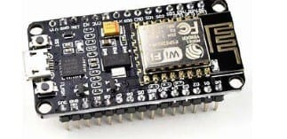<br>**Microcontroller board** | 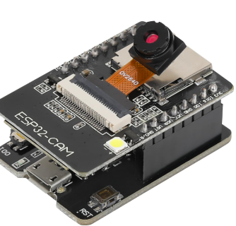<br>**ESP32-CAM** | 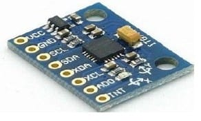<br>**MPU6050** |
| 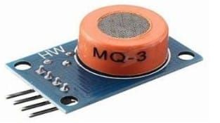<br>**MQ-3 alcohol sensor** | 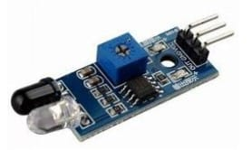<br>**IR sensor** | 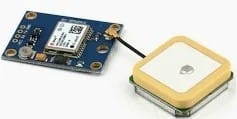<br>**NEO-6M GPS** |
| 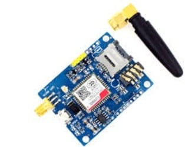<br>**SIM800 GSM module** | 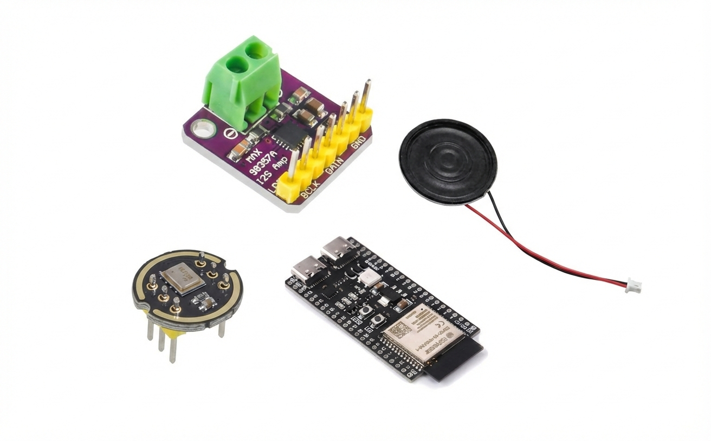<br>**Voice assistant module** | 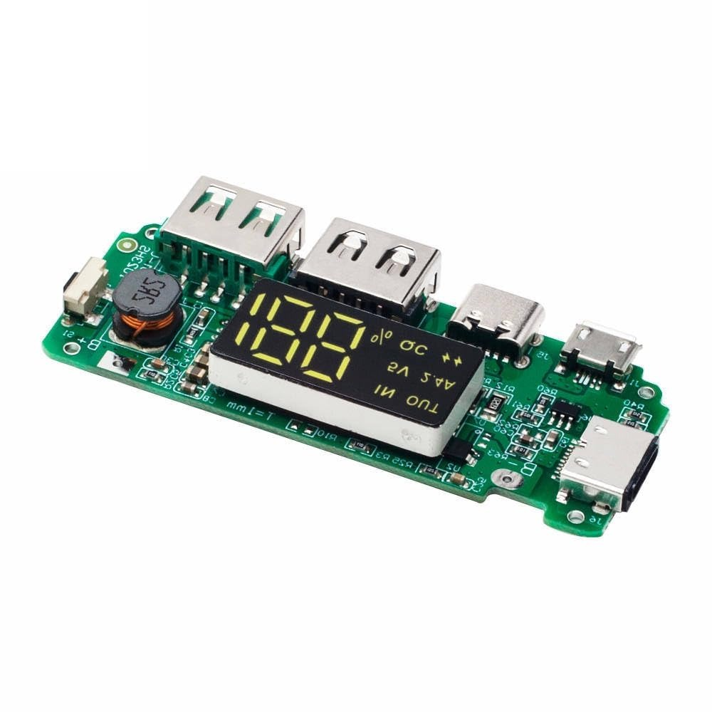<br>**3-port USB power bank module** |

---

## ⚙️ How It Works

### 1. Alcohol detection
The MQ-3 analog output is read on an ESP32 ADC pin. If the reading exceeds the preset threshold:
- Engine ignition is disabled through the relay
- The buzzer sounds
- A warning message can be transmitted

### 2. Helmet-worn detection
The IR sensor's digital output is read on an ESP32 GPIO. If the helmet is not detected, the relay blocks ignition and the buzzer warns the rider, which enforces helmet compliance.

### 3. Accident detection and SOS

```
Sudden impact detected
        │
        ▼
Threshold exceeded?  ──No──▶ keep monitoring
        │ Yes
        ▼
Verification delay (filters false triggers)
        │
        ▼
Emergency protocol activated
        │
        ├──▶ Fetch GPS coordinates
        └──▶ Send SMS via GSM module
```

### 4. Emergency SMS contents
- Accident notification
- Google Maps location link
- Rider identification details

---

## 🔌 Wiring Overview

| Module | Interface | Notes |
|---|---|---|
| NEO-6M GPS | UART | Provides latitude, longitude, timestamp |
| SIM800L GSM | UART | 4V–5V regulated supply |
| MQ-3 | ADC (analog) | Alcohol concentration |
| IR sensor | GPIO (digital) | Helmet worn / not worn |
| MPU6050 | I²C | Motion and tilt |
| Relay | GPIO | Ignition control |
| Buzzer | GPIO | Alerts |

Pin assignments depend on your build. Define them at the top of your firmware.

---

## 💻 Software Stack

- **Firmware**: Arduino IDE (C/C++) for ESP32 and ESP32-CAM
- **IoT platform**: Blynk Console, with MQTT and HTTP/HTTPS for cloud connectivity
- **Vision / AI**: OpenCV, CNN / Haar Cascade, TensorFlow Lite
- **Voice**: speech-to-text / text-to-speech APIs and an LLM-based assistant

---

## 🚀 Getting Started

### Prerequisites
- Arduino IDE with the **ESP32 board package** installed
- A Blynk account and a configured template and device
- An active SIM card with SMS capability for the SIM800L
- The hardware listed above

### Setup

```bash
# 1. Clone the repository
git clone https://github.com/<your-username>/smart-ai-helmet.git
cd smart-ai-helmet
```

1. Open the firmware sketch in the Arduino IDE.
2. Install the required libraries (e.g., Blynk, TinyGPS++, and an MPU6050 library).
3. Set your configuration values:
   ```cpp
   #define BLYNK_AUTH_TOKEN "YOUR_TOKEN"
   const char* ssid = "YOUR_WIFI";
   const char* pass = "YOUR_PASSWORD";
   String emergencyNumber = "+91XXXXXXXXXX";
   ```
4. Select your ESP32 board and port, then upload.
5. Mount the electronics in a protective enclosure at the **rear of the helmet** to keep the center of gravity and aerodynamics intact.

> ⚠️ This is a prototype and has not been certified. Do not rely on it as a replacement for a certified helmet.

---

## 📨 Sample Emergency SMS

```
Accident! Loc:
http://maps.google.com/?q=<latitude>,<longitude>
```

<p align="center">
  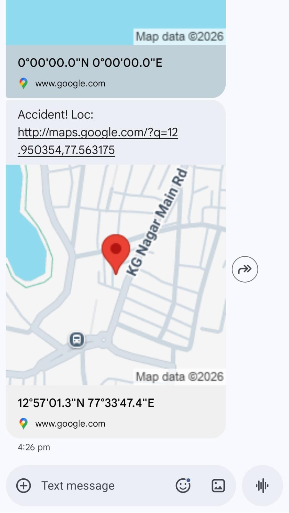
</p>

The Blynk dashboard also shows live eye state, strap status, alcohol level, overall status (e.g., `ACCIDENT!`) and the location link.

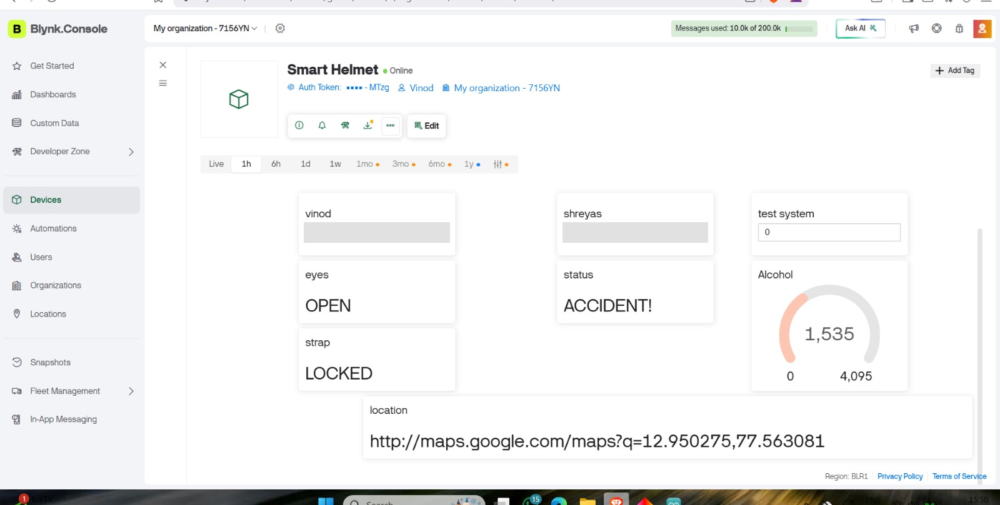
*Blynk console showing eyes, strap, status, alcohol level and location.*

---

## 🏭 Applications

- Two-wheeler rider safety
- Construction sites
- Mining industries
- Industrial workplaces
- Fleet monitoring

---

## 🔍 Research Gaps Addressed

- Integration of multiple AI techniques in a single helmet
- Power consumption and battery life
- False-positive reduction in accident detection
- Evaluation under diverse conditions and real-world deployment

---

## 🔮 Future Work

- Full on-device drowsiness detection using the ESP32-CAM
- Multi-sensor fusion (accelerometer, gyroscope, GPS) to further reduce false positives
- Navigation support and smarter voice warnings
- Heart rate, temperature and gas sensors for industrial use
- Extended field testing and power optimisation

---

## 📚 References

Key reference: World Health Organization, *Global Status Report on Road Safety 2023*. https://www.who.int/publications/i/item/9789240077611

Further references on smart helmets, drowsiness detection and IoT-based accident systems are listed in the accompanying paper.

---

## 📄 License

Add your license here (e.g., MIT).

## 🤝 Contributing

Issues and pull requests are welcome.
